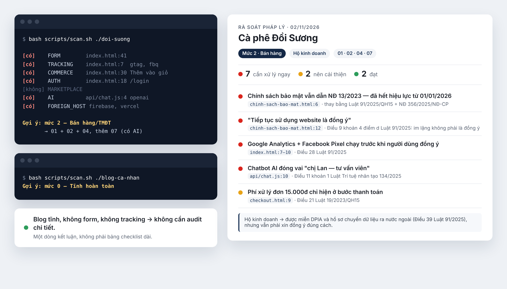

# vn-law-check

Checklist + rules cho AI coding agent audit sơ bộ pháp lý website Việt Nam: dữ liệu cá nhân, thương mại điện tử, an ninh mạng, bảo vệ người tiêu dùng, quảng cáo, giao dịch điện tử, minh bạch AI.



Ảnh trên chạy trên một [shop demo](demo/site/) cố ý chứa các lỗi thường gặp. Xem [báo cáo đầy đủ](demo/report.md): mỗi phát hiện có file:dòng và số điều luật.

Không phải tư vấn pháp lý, xem [DISCLAIMER.md](./DISCLAIMER.md). Luật VN ở mảng này vừa đổi gần hết trong 2025–2026, nên tự xác minh lại trước khi dựa vào.

### Cài nhanh

Dùng Claude Code — cài qua plugin marketplace (gõ trong Claude Code, không phải terminal):

```
/plugin marketplace add mhfed/vn-law-check
/plugin install vn-law-check
```

Hoặc clone thẳng vào thư mục skills, không cần qua marketplace:

```bash
git clone --depth=1 https://github.com/mhfed/vn-law-check ~/.claude/skills/vn-law-check
```

(muốn cài riêng cho 1 project thì đổi `~/.claude/skills/` thành `.claude/skills/` trong project đó)

Dùng Cursor/Windsurf/Copilot/Cline/Codex — chạy trong thư mục project:

```bash
curl -fsSL https://raw.githubusercontent.com/mhfed/vn-law-check/main/install.sh | bash
```

Script cài checklist vào `.vn-law-check/` và không ghi đè file nào của bạn. Nếu project đã có `AGENTS.md`, `CLAUDE.md`... thì script chỉ chèn thêm một đoạn ngắn trỏ tới `.vn-law-check/`. Chạy lại để cập nhật cũng không bị chèn trùng.

Xong thì bảo agent: "audit pháp lý website này theo luật Việt Nam". Agent sẽ tự quét code để phân loại site trước. Blog hay trang tĩnh không thu thập gì thì chỉ nhận về 1 dòng kết luận, không phải bảng checklist dài.

### Vì sao làm cái này

Rules compliance có sẵn trên GitHub cho AI agent gần như toàn GDPR/CCPA. Chưa có cái nào theo luật Việt Nam — mà luật VN vừa thay gần hết: Luật Bảo vệ dữ liệu cá nhân 2025, Luật Thương mại điện tử 2025, Luật An ninh mạng 2025 đều mới có hiệu lực trong 2026, thay các nghị định cũ.

### Dùng với tool nào

Cùng một nội dung, đặt ở nhiều file để mỗi tool tự đọc đúng chỗ của nó, không cần config gì thêm:

- `AGENTS.md` — chuẩn chung (Cursor, Codex, Jules, Amp, Zed...)
- `CLAUDE.md` — Claude
- `SKILL.md` — Claude Skill, cho vào `.claude/skills/`
- `.claude-plugin/marketplace.json` + `plugins/vn-law-check/` — để cài qua `/plugin marketplace add` trong Claude Code
- `.cursor/rules/vn-legal-compliance.mdc` — Cursor
- `.windsurfrules` — Windsurf
- `.github/copilot-instructions.md` — GitHub Copilot
- `.clinerules` — Cline

### Cấu trúc

```
references/   00-triage (phân loại site trước khi audit) + 8 checklist theo lĩnh vực
scripts/      scan.sh — quét source code, phát hiện form/tracking/giỏ hàng/đăng nhập/AI/hosting, gợi ý mức audit
sources/      văn bản pháp luật dẫn chiếu, ngày hiệu lực, link
examples/     mẫu báo cáo: rút gọn (site nhỏ) và đầy đủ (bán hàng, nền tảng)
tests/        site mẫu để kiểm tra scan.sh phân loại đúng
tools/        sync.sh — sinh các bản copy cho từng tool từ nguồn gốc
```

`scan.sh` chỉ đọc file local, không gửi gì ra ngoài.

### Tình trạng nội dung

Cập nhật 02/11/2026, theo các văn bản mới nhất: Luật BVDLCN 91/2025 + NĐ 356/2025, Luật TMĐT 122/2025 + NĐ 248/2026, Luật An ninh mạng 116/2025 + NĐ 333/2026, Luật Quảng cáo sửa đổi 75/2025 + NĐ 342/2025, Luật Trí tuệ nhân tạo 134/2025 + NĐ 142/2026.

Mỗi mục checklist có dẫn Điều/khoản. Số điều nào chưa đối chiếu được với toàn văn thì ghi "CHƯA XÁC MINH" ngay tại chỗ, phần lớn là các nghị định xử phạt. Toàn bộ link văn bản ở `sources/legal-references.md`.

### Đóng góp

PR cập nhật văn bản, sửa sai sót đều được hoan nghênh — nhớ trích nguồn (số hiệu văn bản, link thuvienphapluat.vn/vbpl.vn) cho mỗi thay đổi.

Chỉ sửa file nguồn gốc: `AGENTS.md`, `SKILL.md`, `references/`, `sources/`, `examples/`, `scripts/`, `DISCLAIMER.md`. Sau đó chạy `tools/sync.sh` để sinh lại `CLAUDE.md`, rules cho Cursor/Windsurf/Copilot/Cline và bản trong `plugins/`. CI sẽ báo lỗi nếu quên đồng bộ. Sửa `scripts/scan.sh` thì chạy `tests/run.sh` để kiểm tra.

MIT license cho phần code/cấu trúc repo. Văn bản pháp luật được dẫn chiếu là tài liệu công khai của Nhà nước, không thuộc phạm vi license này.
